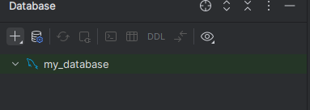
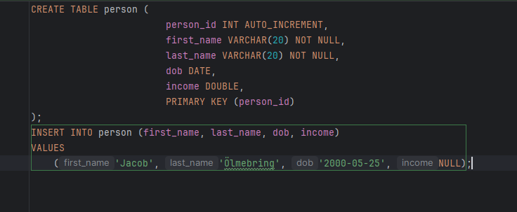
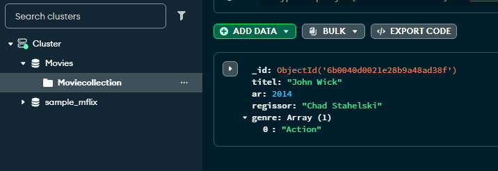
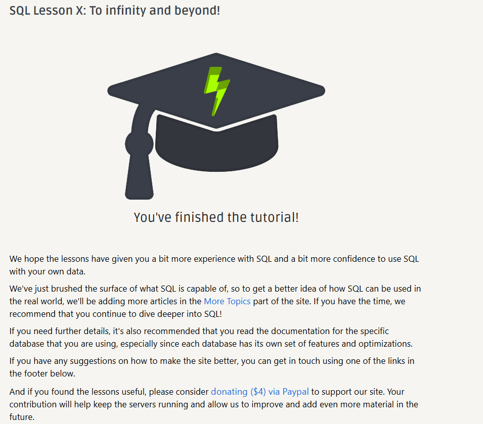

1. En databas är en samling av information som lagras så att den kan sökas och hanteras. Används mycket inom konton samt
   appar med mera.

2. SQL används för databaser, att kommunicera, hämta, lägga till, uppdatera samt radera data. Detta används mycket inom
   mitt drömjobb; på bank eller försäkringsbolag!

3. En tabell är en struktur som samlar data om en specifik sak, uppbyggd ungefär som ett kalkylblad. En rad motsvarar
   ett enskilt objekt i tabellen, medan en kolumn beskriver en viss egenskap hos objekten

4. En primärnyckel är en kolumn som har ett helt unikt värde för varje rad i en tabell. Den behövs för att säkert kunna
   identifiera och skilja på två rader även om de råkar ha identiska värden i övriga kolumner, till exempel två personer
   med exakt samma namn

5. En främmande nyckel är en kolumn i en tabell som pekar på primärnyckeln i en annan tabell. Den används för att koppla
   ihop data och skapa relationer mellan olika tabeller

6. Varför är det bra att lagra kunduppgifter och köp i olika tabeller? Att dela upp data i olika tabeller undviker
   redundans. Det minskar risken för fel vid uppdateringar eftersom du bara behöver ändra kundens adress på ett ställe i
   databasen

7. NoSQL är ett samlingsnamn för databaser som inte använder
   traditionella relationstabeller med fasta
   kolumner. Informationen kan i stället organiseras som dokument, nyckel-värde-par,
   grafer eller breda kolumner.

8. En NoSQL-databas är lämplig för exempelvis en e-handelskatalog där olika produkter har helt olika egenskaper (en
   tröja har storlek och färg, medan en dator har processor och RAM-minne) Eftersom databaser saknar ett fast
   schema slipper man skapa hundratals tomma kolumner och kan enkelt lagra olika typer av objekt i samma samling!

9.

SELECT * FROM person;

10.

SELECT förnamn, efternamn FROM person;

11.

SELECT förnamn, efternamn, inkomst FROM person
WHERE inkomst > 30000;

12.

SELECT * FROM person
WHERE fodelsedatum < '1990-01-01';

13.

SELECT fornamn, efternamn, inkomst FROM person
ORDER BY inkomst DESC;

14.

SELECT COUNT (*) FROM person;

VG NIVÅ

1.

När en banköverföring genomförs behöver databasen utföra minst två operationer. Först dras pengarna från avsändarens
konto genom en UPDATE, och därefter läggs samma belopp till på mottagarens konto. Om systemet exempelvis kraschar efter
den första operationen, innan den andra har genomförts, kan det uppstå problem. Pengarna har då dragits från avsändarens
konto utan att nå mottagaren, vilket gör att kontosaldona inte längre stämmer.
Hur transaktioner i databaser löser problemet
För att förhindra sådana situationer använder relationsdatabaser transaktioner. Det innebär att flera databasoperationer
behandlas som en enda enhet. Antingen genomförs alla operationer eller så avbryts hela processen.
Detta är en del av de så kallade ACID-egenskaperna (Atomicity, Consistency, Isolation och Durability). I det här
exemplet är framför allt Atomicity, eller atomicitet, viktig. Den ser till att en transaktion antingen genomförs helt
eller att alla ändringar ångras om något går fel.
När en banköverföring påbörjas används exempelvis kommandot BEGIN TRANSACTION eller START TRANSACTION. Databasen börjar
då samla ändringarna i en gemensam transaktion. Om något problem uppstår innan överföringen är färdig kan kommandot
ROLLBACK användas. Det återställer databasen till läget innan transaktionen startade, vilket innebär att avsändarens
ursprungliga saldo återställs.
Om båda kontoändringarna genomförs utan problem avslutas transaktionen istället med COMMIT. Då sparas ändringarna i
databasen. På så sätt kan banken undvika att en överföring bara genomförs delvis, även om systemet skulle drabbas av ett
avbrott.

2.

När man bygger en webbutik behöver man spara många olika typer av information, till exempel kunduppgifter,
beställningar, lagersaldo och själva produkterna. Beroende på vad man ska lagra och hur det ska användas passar antingen
en relationsdatabas eller en NoSQL-databas bäst.
När en relationsdatabas passar bäst
En relationsdatabas (som MySQL) passar bäst för att hålla koll på kunder, beställningar, betalningar och lagersaldo. Den
här informationen hänger tätt ihop och följer alltid samma mönster. En kund kan göra flera beställningar, och varje
beställning innehåller en eller flera varor.
I en relationsdatabas delar man upp detta i olika tabeller, som Kunder, Ordrar och Produkter, och kopplar ihop dem med
hjälp av unika ID-nummer (nycklar). Fördelen är att man slipper skriva in kundens namn och adress på nytt varje gång
kunden handlar. Dessutom är relationsdatabaser väldigt säkra när flera saker händer samtidigt. Om två kunder klickar på
"köp" för den sista tröjan i lager exakt samtidigt ser databasen till att bara en av dem får den, så att lagersaldot
inte hamnar på minus.
När en NoSQL-databas passar bäst
En NoSQL-databas (som MongoDB) passar i stället väldigt bra för själva produktkatalogen i en stor webbutik som säljer
många olika sorters varor. Tänk på en butik som säljer både kläder och datorer. En tröja behöver information om storlek
och färg, medan en dator behöver information om skärmstorlek och minne.
I en vanlig tabell hade det blivit rörigt med massor av tomma rutor för egenskaper som inte passar alla varor. I en
NoSQL-databas sparas i stället varje produkt som ett eget litet dokument (likt en textfil) där varje vara får ha exakt
de egenskaper den behöver. Det gör också att det går blixtsnabbt att ladda en produktsida för kunden, eftersom all
information om varan, inklusive bilder och recensioner, redan ligger samlad på ett och samma ställe och kan hämtas på en
gång.
Sammanfattningsvis är en relationsdatabas bäst när det krävs hög säkerhet och ordning på beställningar och betalningar,
medan NoSQL är bäst när man behöver lagra olika typer av produkter på ett snabbt och flexibelt sätt.

